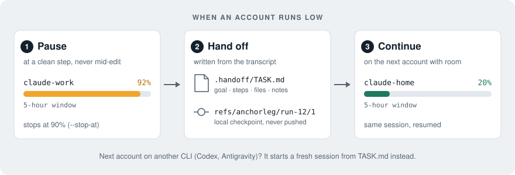
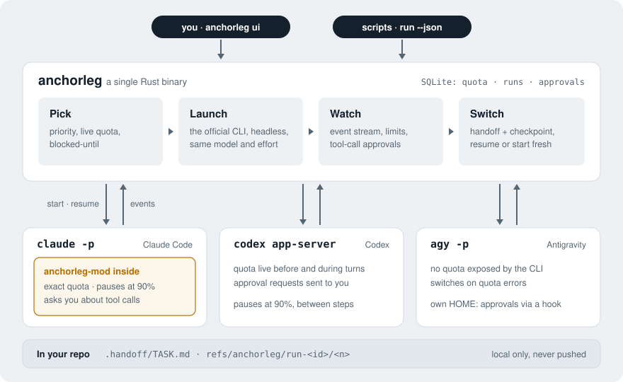
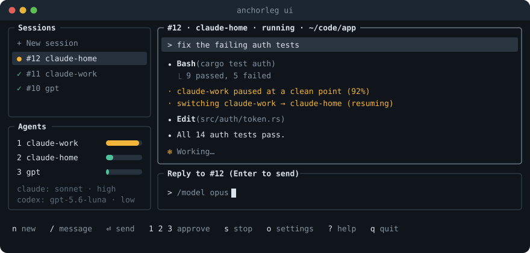

<h1 align="center"></h1>

<p align="center">
  <b>Keep your coding agents working when an account hits its limit.</b><br>
  A session manager for Claude Code and Codex (Antigravity coming) that pauses a task at a clean point
  when an account runs low and continues it on another of your accounts.
</p>

<p align="center">
  <a href="https://github.com/snehal96/anchorleg/actions/workflows/ci.yml"></a>
  <a href="#license"></a>
  
  <a href="https://github.com/snehal96/anchorleg/releases/latest"></a>
  
</p>

---

Long agent runs die at the worst moment: the 5-hour window fills up at 92% of the work, or the
weekly limit lands mid-refactor. If you have more than one account, you end up copying context
by hand and starting over.

`anchorleg` does that for you. It starts the official CLI (`claude`, `codex` or `agy`) headless,
watches every account's quota, and when one gets close to its limit it:

1. **pauses** the task before the next model request, never in the middle of an edit,
2. **hands off**: writes `.handoff/TASK.md` and a local git checkpoint of your working tree,
3. **continues** the same session on your next account, with its transcript and project memory.

<p align="center">
  
  <br><sub>Recorded with <a href="scripts/demo/demo.tape">vhs</a> against stand-in CLIs, so no quota was spent.</sub>
</p>

<p align="center">
  
</p>

## Contents

- [Features](#features)
- [How it works](#how-it-works)
- [Install](#install)
- [Set up your accounts](#set-up-your-accounts)
- [Using anchorleg](#using-anchorleg)
- [Settings](#settings)
- [Ground rules](#ground-rules)
- [Supported CLIs](#supported-clis)
- [FAQ](#faq)
- [Troubleshooting](#troubleshooting)
- [Contributing](#contributing)
- [License](#license)

## Features

- **Switches before you hit the wall.** anchorleg sees exact usage while the task runs (a small
  mod inside Claude Code; Codex reports it itself) and stops at a step boundary once any window
  reaches 90% (`--stop-at`). If no account has more room, the task carries on until the real
  limit, then switches.
- **Keeps the context.** The next account gets the session transcript, subagent transcripts and
  project memory, and resumes the session. When the context is large (over 100k tokens by
  default) it starts fresh from the handoff instead, so the next account doesn't pay for an
  uncached re-read.
- **A session manager in your terminal.** `anchorleg ui` lists every session with its live
  conversation (in Claude Code's style), takes new tasks and replies, and shows each account's
  quota. Keyboard first; the mouse works too.
- **Send screenshots and files.** Paste an image (Ctrl+V) or drop a file into `anchorleg ui`, or
  pass `--attach`; both Claude Code and Codex read it, also after a switch.
- **See what it changed.** `v` in the UI (or `anchorleg diff`) shows the session's own changes
  since it started, and the agent's task list shows under the conversation as it works.
- **Tells you when it needs you.** A desktop notification when a session waits for an answer,
  finishes, fails or switches accounts; `anchorleg notify --command …` sends the same to your own
  script (a chat bot, a phone push).
- **Work toward a goal.** `--goal "cargo test passes"` (or `/goal` in the UI): the session keeps
  going, turn after turn, until the agent shows the condition holds, even when it moves to another
  account or another CLI on the way.
- **A second opinion.** `anchorleg review 12` (or `/review` in the UI): another account, or
  another CLI with `--cli codex`, reviews what session #12 changed, without touching files;
  `--fix` sends the findings back to #12 to fix.
- **Plan first.** `--plan` (or `/plan` in the UI): the agent plans in Claude's or Codex's plan
  mode, you approve or say what to change, then the same session carries it out.
- **The agent can ask you.** When Claude or Codex needs a decision, the question and its options
  show up in `anchorleg ui` (or `anchorleg permission list`) and the run waits for your answer.
- **You approve what the agent may do.** A background run can't show the CLI's permission
  prompt, so anchorleg asks you: the session waits until you press **1** yes, **2** yes for this
  session or **3** no. Works for Claude Code and Codex. Nobody watching? `--mode auto` lets
  Claude Code's auto mode or Codex's auto-review decide instead, and shows what it decided.
- **See what you're using.** `anchorleg usage` (and `u` in `anchorleg ui`) shows tokens and
  cost per account and model, tokens per day, quota bars and each account's usage credits.
  Cost is the API list price of the same tokens, so you can see what your subscriptions save.
- **Never spends money behind your back.** Usage credits (Claude extra usage, Codex credits)
  are off limits unless you allow them per account: as a last resort, or always.
- **Same model and effort on every account.** One setting per provider (`/model opus`,
  `/effort high`), so a task keeps the same strength when it moves. Your own slash commands and
  skills pass straight through.
- **Safe with your repo.** Checkpoints are local refs under `refs/anchorleg/`; anchorleg never touches
  your branch, index or stash, and never pushes.
- **Scriptable.** Every command has `--json` output and stable exit codes, so a task delegator, a
  CI job or another agent can run anchorleg as a subprocess.

## How it works

<p align="center">
  
</p>

- **anchorleg** (`crates/`) is a single Rust binary: account registry, quota store (SQLite), switch
  policy, the supervisor that runs the CLI, the TUI and the JSON contract.
- **anchorleg-mod** (`mod/`) is a Claude Code mod embedded in the binary and loaded into every run
  with `--plugin-dir`. It reads usage, stops turns and forwards permission questions. It never
  touches credentials.
- **Codex** has no mod: anchorleg runs it through `codex app-server`, which reports quota before
  and during every turn and sends its approval requests to anchorleg. **Antigravity** (under development) shows no
  quota, so anchorleg switches when a turn fails on quota; an agy login with its own `HOME` gets
  approvals through an agy hook. Moving between different CLIs always starts fresh from `.handoff/TASK.md`.

Every CLI behaviour anchorleg relies on is checked against real runs; the captured output lives
in [`fixtures/`](fixtures) and the tests replay it. Command and JSON reference:
[docs/CLI.md](docs/CLI.md).

## Install

Requirements:

- macOS (Apple silicon or Intel) or Linux (x86_64 or arm64, glibc 2.35+, e.g. Ubuntu 22.04+).
  Linux is newer and less tested with real accounts.
- At least one agent CLI, signed in on each account you want to use:
  [Claude Code](https://docs.claude.com/en/docs/claude-code) (`claude`) or
  Codex (`codex`, or the copy inside the ChatGPT desktop app). Antigravity (`agy`) is under
  development.

**Install script** (macOS and Linux): downloads the latest release for your machine, checks its
SHA-256 and puts `anchorleg` in `~/.local/bin`:

```bash
curl -fsSL https://raw.githubusercontent.com/snehal96/anchorleg/main/install.sh | bash
anchorleg --version
```

Set `ANCHORLEG_INSTALL_DIR` to install somewhere else, or `ANCHORLEG_VERSION=v0.1.0` to pin a
version. Run it again to update; delete the binary to remove it.

**Debian / Ubuntu** (`.deb`):

```bash
arch=$(dpkg --print-architecture)   # amd64 or arm64
curl -fsSLO "https://github.com/snehal96/anchorleg/releases/latest/download/anchorleg_0.4.0-1_${arch}.deb"
sudo apt install "./anchorleg_0.4.0-1_${arch}.deb"
```

**Prebuilt binaries:** every [release](https://github.com/snehal96/anchorleg/releases/latest)
has `anchorleg-<target>.tar.gz` for `aarch64-apple-darwin`, `x86_64-apple-darwin`,
`x86_64-unknown-linux-gnu` and `aarch64-unknown-linux-gnu`, with `.sha256` files and
`SHA256SUMS`.

**From source** (needs [Rust](https://rustup.rs) stable):

```bash
cargo install --git https://github.com/snehal96/anchorleg anchorleg
```

**Homebrew** (`brew install snehal96/tap/anchorleg`) is coming soon.

## Set up your accounts

An account is simply the command you would type to start it. Most people keep one Claude config
folder per account and an alias for each:

```bash
# in ~/.zshrc
alias claude-work='CLAUDE_CONFIG_DIR=~/.claude-work claude'
alias claude-home='CLAUDE_CONFIG_DIR=~/.claude-home claude'
```

Import them (anchorleg reads your aliases and shows what it would add first):

```bash
anchorleg accounts import-aliases          # preview
anchorleg accounts import-aliases --yes    # save
anchorleg accounts list                    # in the order they're tried
```

Or add them one by one:

```bash
anchorleg accounts add work --cmd "CLAUDE_CONFIG_DIR=~/.claude-work claude" --priority 1
anchorleg accounts add home --cmd "CLAUDE_CONFIG_DIR=~/.claude-home claude" --priority 2
anchorleg accounts add ci --token-stdin             # a `claude setup-token` token, kept in the keychain
anchorleg accounts add gpt --cmd "CODEX_HOME=~/.codex codex" --priority 3   # a Codex login
anchorleg accounts add gemini --vendor antigravity --priority 4             # agy (under development), your own HOME
anchorleg accounts add gemini2 --cmd "HOME=~/.agy-2 agy" --priority 5       # agy (under development), its own HOME (sign in once with `HOME=~/.agy-2 agy`)
anchorleg accounts show work                        # the exact command anchorleg will run
```

Accounts live in `~/.config/anchorleg/config.toml`. You can also reorder, disable and import them in
`anchorleg ui` (Agents pane).

## Using anchorleg

### The session manager

```bash
anchorleg ui
```

<p align="center">
  
</p>

| Key | What it does |
|---|---|
| `n` | New session: pick the folder, type the task, Enter |
| `/` or `m` | Type a message: a reply to the selected session, or a new task |
| `Enter` | Send |
| `1` `2` `3` | Answer a waiting tool call: yes · yes for this session · no |
| `s` | Stop the selected session |
| `v` | What the selected session changed (a diff) |
| `U` `U` | Undo the selected session's changes (`anchorleg undo --redo` brings them back) |
| `Tab` | Next pane (in the message box: complete a slash command) |
| `?` | All keys |

Sessions run as background processes, so they keep going when you close the UI.

### From the command line

```bash
anchorleg run --cwd ~/code/app -- "fix the failing auth tests"
anchorleg run --follow-up 12 -- "now add a test for the expired-token case"
anchorleg sessions                  # recent sessions
anchorleg status                    # quota per account, and who runs next
anchorleg usage                     # tokens and API-price cost per account and model, last 7 days
anchorleg send 12 -- "also update the docs"   # message a working session (--interrupt: now)
anchorleg run --attach error.png -- "fix this crash"   # attach images or files (also on send)
anchorleg run --plan -- "split the auth module"         # plan first; approve, then it runs
anchorleg run --goal "cargo test passes" -- "migrate to the new API"   # keep going until it holds
anchorleg review 12 --cli codex --fix                   # another CLI reviews #12; #12 fixes the findings
anchorleg run --worktree -- "try the new parser"        # in a git worktree of its own
anchorleg run --fork 12 -- "now try it with a macro"    # a new session from #12's history
anchorleg stop 12                   # stop a session and its CLI
anchorleg diff 12 --stat            # what the session changed since it started
anchorleg permission list           # tool calls waiting for you
anchorleg permission answer 3 yes   # yes | always | no
anchorleg permission answer 4 2     # an agent's question: option number, label or your own words
```

### From another program

Every command prints one JSON object with `--json` and exits with a stable code:

```bash
anchorleg run --json --cwd ~/code/app -- "fix the failing auth tests"
```

```json
{ "schema": 1, "run_id": 12, "outcome": "done", "result": "All 14 auth tests pass.",
  "session_id": "4f6c…", "accounts_used": ["claude-work", "claude-home"],
  "switches": [{ "from": "claude-work", "to": "claude-home", "rule": "quota_stop", "at": 1791450000 }] }
```

| Exit | Outcome |
|---|---|
| 0 | done |
| 1 | the task failed |
| 2 | bad arguments |
| 75 | every account is blocked (with `--no-wait`); see `wait_until` |
| 78 | no account configured |
| 130 | stopped |

The full contract: [docs/CLI.md](docs/CLI.md).

## Settings

One set per provider, shared by all its accounts:

```bash
anchorleg settings claude --model sonnet --effort high
anchorleg settings claude --args "--permission-mode acceptEdits"   # let runs edit without asking
anchorleg settings                                                  # show all
```

In `anchorleg ui`, type `/model opus` or `/effort high` in the message box. Any other `/command` goes
to Claude as usual: your skills, custom commands and built-ins such as `/compact`.

### Which account goes first

Blocked accounts are skipped, and an account at 95% or more is used only when nothing healthier
is free. Among the rest, the **policy** decides:

| Policy | Picks | Good for |
|---|---|---|
| `drain` (default) | priority order | one main account, others as backup |
| `balance` | the least used (fullest window) | several equal subscriptions |
| `save-weekly` | the most weekly room left | weekly limits running out before the week ends |

```bash
anchorleg policy balance                        # the default for every run (no name: show it)
anchorleg run --policy save-weekly -- "…"       # just this run
anchorleg run --prefer work -- "…"              # this account first while it has room
anchorleg run --account work -- "…"             # only this account, no switching
anchorleg accounts set work --pinned true       # always first while it has room
anchorleg accounts set home --reserve-7d 0.2    # keep its last 20% of the week for emergencies
anchorleg accounts set side --priority 3 --enabled false
anchorleg accounts set home --credits last-resort  # pay from extra usage only when all are out
```

**Usage credits** (Claude's extra usage, Codex credits) are never spent by default: if a CLI
starts paying past its plan's limit, anchorleg stops it and moves the task on. Set `--credits
last-resort` to pay only when every account is out instead of waiting, or `allow` to keep going
on credits. `anchorleg status`, `anchorleg usage` and `anchorleg ui` show each account's credits.

In `anchorleg ui`, press `p` in the Agents pane to change the policy.

`anchorleg run` options worth knowing:

| Option | Default | What it does |
|---|---|---|
| `--stop-at F` | `0.9` | Pause at a clean point once any window reaches this fraction |
| `--fresh-above N` | `100000` | At a switch, start fresh from the handoff above this many context tokens |
| `--model M` | provider setting | Model for this run only |
| `--policy P` | `anchorleg policy` | `drain`, `balance` or `save-weekly`, for this run |
| `--prefer A` / `--account A` | none | Try account A first / use only account A |
| `--no-wait` | off | If every account is blocked, exit 75 instead of waiting for a reset |
| `--no-mod` | off | Run without anchorleg-mod: switch only on hard limits, no approvals |

### The handoff file

On every pause or limit, anchorleg writes `.handoff/TASK.md` in the task's folder, from the
transcript and without calling a model: the goal and later messages, the agent's task list, its
last message, files written, edited and read, recent commands and `git status`. Agents keep
their decisions and dead ends under `## Notes`, which anchorleg preserves. The folder ignores itself
in git. Any agent, or you, can finish the task from it.

Checkpoints:

```bash
git for-each-ref refs/anchorleg              # list them
git diff refs/anchorleg/run-12/1             # what changed since the switch
git checkout refs/anchorleg/run-12/1 -- .    # restore the files as they were
```

## Ground rules

anchorleg is built to use your subscriptions the way their CLIs are meant to be used.

- It only starts the official binaries (`claude`, `codex`, `agy`; later `cursor-agent`),
  exactly as you would.
- It never extracts subscription tokens, never calls vendor APIs directly and never runs a
  proxy that turns a subscription into an API.
- Inside a session, anchorleg-mod only reads usage, stops at a step boundary and forwards
  permission questions. Switching happens outside, by relaunching the CLI.
- Tokens, if you use them, live in the system keychain (macOS Keychain, or the Secret Service
  such as GNOME Keyring on Linux), never in config, logs or test data.
- Checkpoints stay local. anchorleg never pushes.
- Nothing is approved without you.

You are responsible for using your accounts within each provider's terms.

## Supported CLIs

| CLI | Status |
|---|---|
| Claude Code (`claude`) | Supported: switching, handoff, approvals, model and effort |
| Codex (`codex`, also bundled with the ChatGPT app) | Supported: live quota before and during every turn, switching, handoff, model and effort, approvals and the soft stop at `--stop-at`. Runs through `codex app-server` with a workspace-write sandbox: edits inside the task folder go ahead, and what Codex asks about (network, writes elsewhere) waits for you |
| Antigravity (`agy`) | **Under development**, not yet validated end to end: switching on quota errors, handoff, model and effort. Quota isn't visible. One account per `HOME`. An account with its own `HOME` gets approvals: edits inside the task folder go ahead, and shell commands and anything else wait for you (anchorleg adds an `anchorleg` hook to that `HOME`'s `.gemini/config/hooks.json`). On your own `HOME`, edits are allowed (`--mode accept-edits`) and shell commands need an allow rule in agy's settings |
| Kimi, Cursor (`cursor-agent`) | Planned |

`anchorleg ui` shows which of these are installed.

## FAQ

**Does anchorleg raise my limits?** No. It uses the accounts you already have, one after another,
and stops each at a clean point.

**Is this allowed?** anchorleg only runs the official CLIs, logged in the way you log in to them
yourself; it doesn't share, pool or resell anything. The clearest use is across providers: a
Claude subscription and a ChatGPT one are separate products, and continuing a task on Codex
when Claude runs low is just using both. Several accounts of the same provider are your call:
read that provider's terms (Anthropic's, for example, forbid sharing an account with anyone
else). Don't use anchorleg to share accounts.

**What about usage credits / extra usage?** Never spent unless you allow it per account
(`--credits last-resort` or `allow`); by default anchorleg stops a launch that starts paying.

**Does it work with one account?** Yes, as a session manager with approvals. With one account
it can only wait for the reset (or exit 75 with `--no-wait`).

**What does a switch cost?** Resuming means the next account reads the session once, uncached.
Above `--fresh-above` tokens anchorleg starts a fresh session from the handoff instead.

**Where is my data?** Config in `~/.config/anchorleg/`, sessions and quota in
`~/Library/Application Support/anchorleg/` (`ANCHORLEG_HOME` to move it). Nothing leaves your machine
except through the CLIs themselves.

## Troubleshooting

- **"no account configured" (exit 78):** run `anchorleg accounts import-aliases --yes` or
  `anchorleg accounts add`.
- **A task can read but not write files:** Claude's default permission mode asks before edits.
  Answer in `anchorleg ui`, or set `anchorleg settings claude --args "--permission-mode acceptEdits"`.
- **The mod doesn't load:** your organisation's managed settings may block mods. anchorleg still
  works without it (`--no-mod`): it switches on hard limits only, with no approvals.
- **More detail:** `ANCHORLEG_LOG=debug anchorleg run …`; every run's raw CLI output is in
  `~/Library/Application Support/anchorleg/runs/run-<id>.jsonl`.

## Contributing

```bash
./scripts/check.sh      # fmt, clippy, tests, and the mod's tests when `claude` is installed
```

The Rust tests replay real captured CLI output from `fixtures/` against a fake CLI, so they
spend no quota. New captures must go through `scripts/scrub-capture.py` before they are
committed. See [CONTRIBUTING.md](CONTRIBUTING.md) for the details; coding agents working on the
repo: [AGENTS.md](AGENTS.md).

## License

Dual-licensed under [MIT](LICENSE-MIT) or [Apache-2.0](LICENSE-APACHE), at your option.
